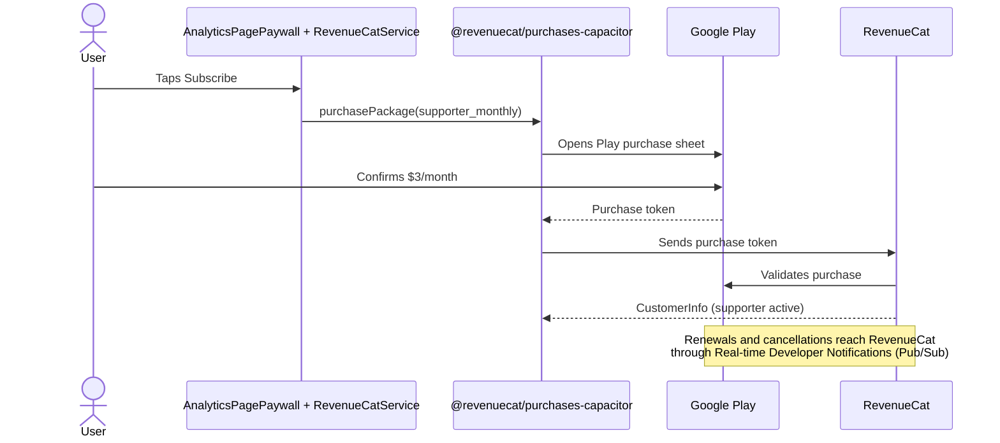
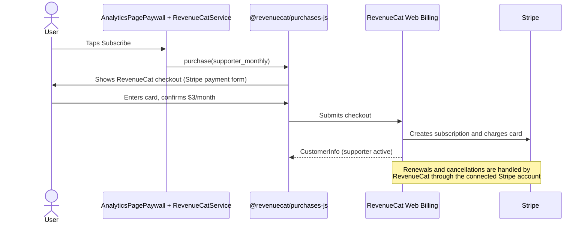
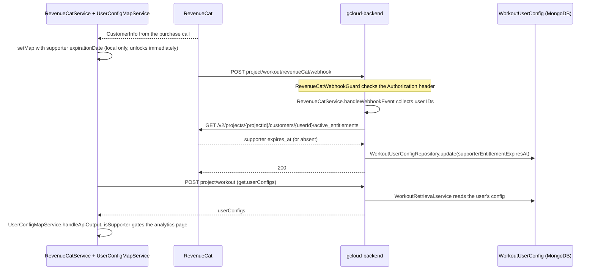

# Payments info

How a MesoPro Supporter purchase moves from the paywall to the unlocked analytics page. Google Play and the web differ only until RevenueCat records the purchase. From there, both follow the same path.

## Google Play (Android app)

## Web (Web Billing with Stripe)

## Shared: RevenueCat to the app

The dashboard admin panel's Sync action reuses `RevenueCatService.syncSupporterEntitlement`, the same fetch and write as the webhook.
