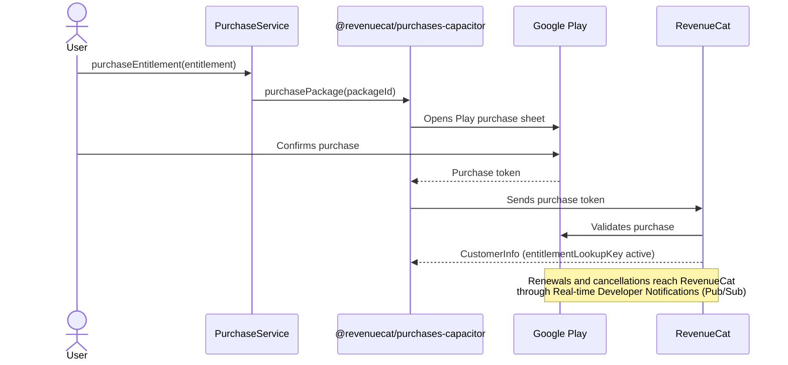
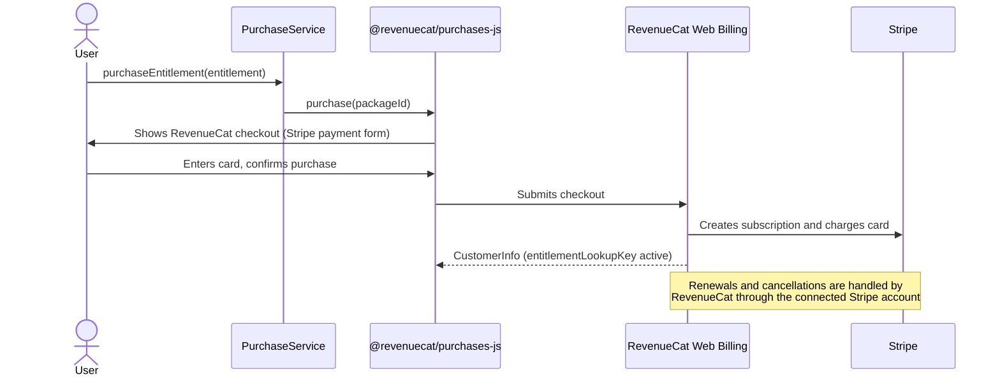
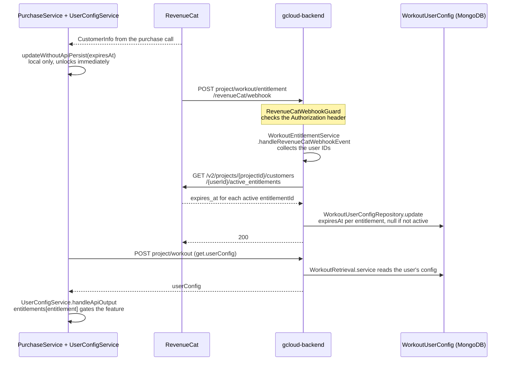

# Payments info

How a purchase of a `WorkoutEntitlement` moves from a subscribe button to the unlocked feature. Google Play and the web differ only until RevenueCat records the purchase. From there, both follow the same path.

## Google Play (Android app)

## Web (Web Billing with Stripe)

## Shared: RevenueCat to the app

Both the webhook and the dashboard admin panel's Sync action use `WorkoutEntitlementService.syncEntitlements` to fetch and write. The webhook syncs every entitlement, and Sync syncs only the entitlements it lists.
